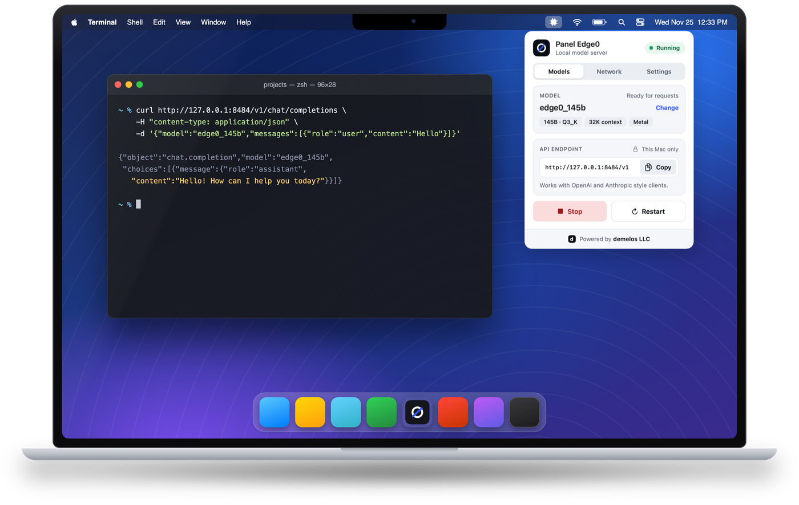
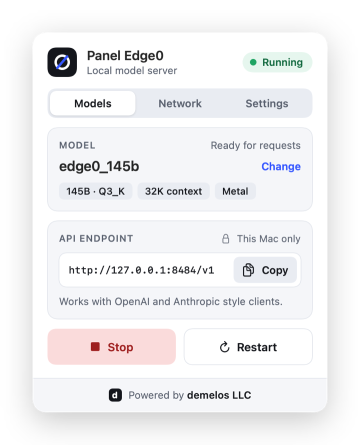
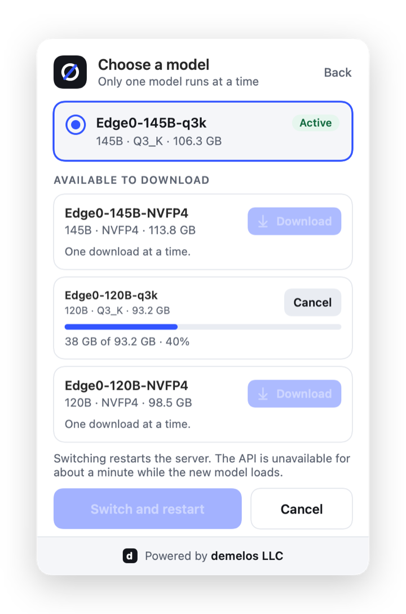
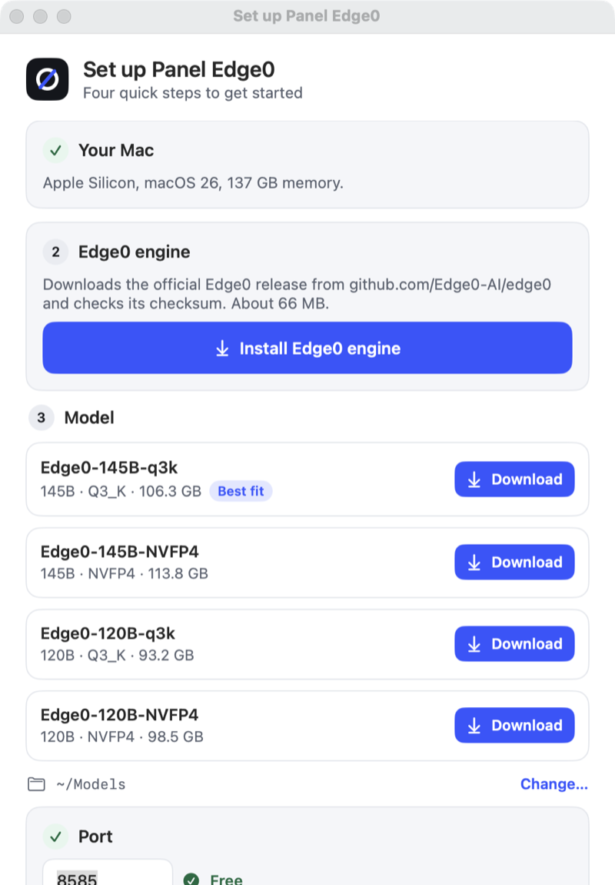
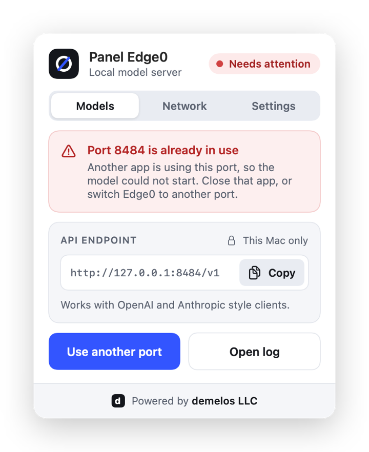
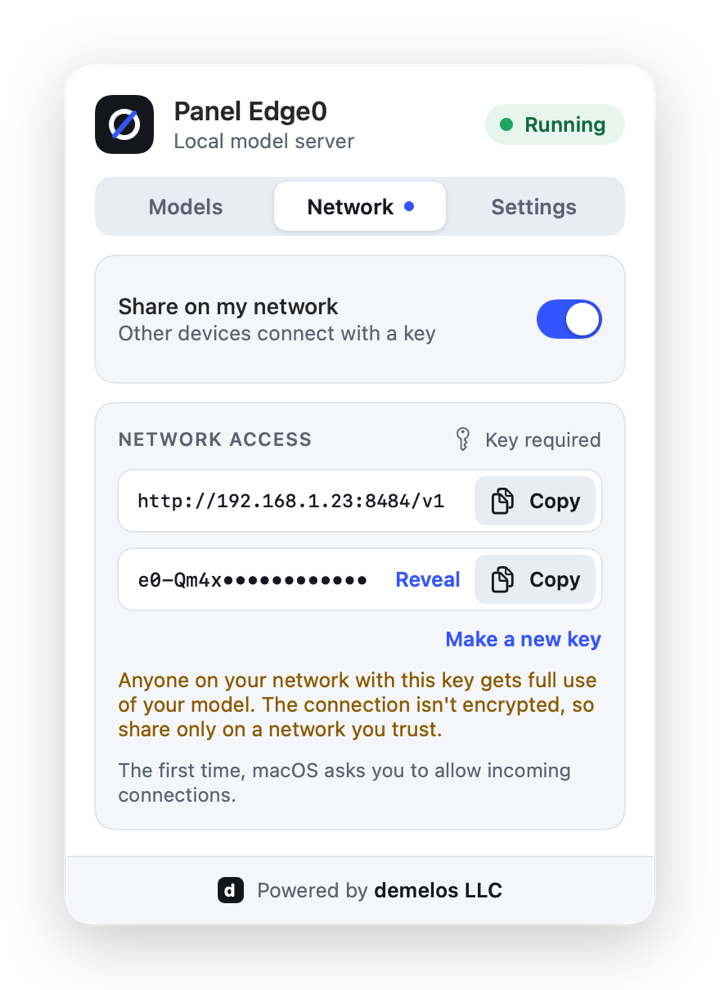
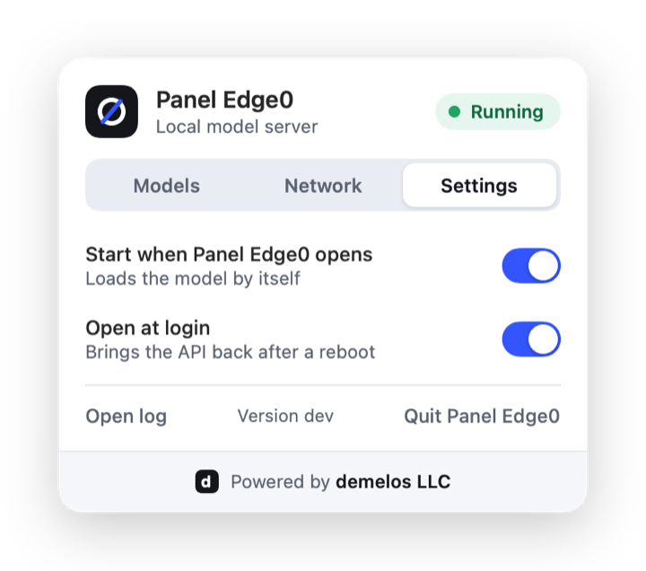

<p align="center">
  
</p>

<h1 align="center">Panel Edge0</h1>

<p align="center"><strong>Edge0 behind the tools you already use.</strong></p>

Panel Edge0 is a menu bar app for Mac. It runs Edge0 models on your Mac and gives every other app one local address to talk to. You don't need Edge0 Chat.

<p align="center">
  <a href="https://github.com/fabiodemelo/edge0-Panel-App/releases/latest"><strong>Download the latest release</strong></a>
  &nbsp;·&nbsp;
  <a href="https://www.demelos.com/tools/edge0/">Product page</a>
</p>

Signed and notarized by Apple. Apple Silicon, macOS 26 or later.

## Why we built it

Edge0 gives you two ways to run a model. You type a server command into a terminal, or you open the Edge0 chat app. Both work. Neither fits when you want the model behind your editor, your IDE or your scripts.

The terminal needs a long command and a port number you keep forgetting. Close the window and the model dies. Reboot and you start over. The chat app opens a window you don't need when the goal is to serve other tools.

So we built Panel Edge0. Install the app, press Start, and the server runs in the background at an address every other tool understands. No terminal. No chat app. Any editor or IDE with a setting for a custom OpenAI or Anthropic style address uses it, on your Mac or across your network.

## What it does

- **One address for every app.** The server answers at `http://127.0.0.1:8484/v1` in the OpenAI or Anthropic style. Out of the box it answers on your Mac only.
- **Share it on your network.** Turn on one switch and other devices reach your Mac's address with an API key. Apps on your Mac need no key. It is off by default.
- **Start and stop in one click.** The icon shows whether the model is loading or ready.
- **Three tabs keep it small.** Models holds the model, the local address and Start, Stop and Restart. Network holds the sharing switch and the key. Settings holds the startup options.
- **Switch models without the terminal.** Pick one from the list, or download the ones you don't have, with a progress bar and a disk space check. Downloads come straight from Hugging Face, with no command-line tools to install.
- **Set up a fresh Mac in four steps.** Setup opens in its own window in the middle of your screen. It checks the Mac, installs the Edge0 engine itself, helps you choose a model and tests your port.
- **A busy port gets fixed, not explained.** During setup it names the app holding your port, suggests the next free one and lets you type your own. Later, one click moves to the next free port.
- **Comes back after a reboot.** Open at login, and the model loads by itself. Light and dark mode follow your Mac. When a new version is out, an Update button appears at the top right. One press downloads it, checks its checksum and Apple signature, installs it and reopens the app.

```sh
curl http://127.0.0.1:8484/v1/chat/completions \
  -H "content-type: application/json" \
  -d '{"model":"edge0_145b","messages":[{"role":"user","content":"Hello"}]}'
```

## Screenshots

Click any image for the full size.

<p align="center">
  <a href="docs/screenshots/running-light.png"></a>
  <a href="docs/screenshots/macbook-pro.png"></a>
</p>
<p align="center">
  <a href="docs/screenshots/model-switcher.png"></a>
  <a href="docs/screenshots/first-run-setup.png"></a>
  <a href="docs/screenshots/port-in-use.png"></a>
</p>
<p align="center">
  <a href="docs/screenshots/network-sharing.png"></a>
  <a href="docs/screenshots/settings-tab.png"></a>
</p>

## Who it's for

Built for you if you want your own tools to use Edge0 models, if you want the model running without a chat window open, if you want the same address after every restart, and if you want to share one Mac's model with other devices on your network.

Look elsewhere if you want a chat window. Panel Edge0 has none. Edge0 Chat, from the Edge0 project, gives you one. Only one copy of a 100 GB model fits in memory, so stop one before you start the other.

## Requirements

- To run: an Apple Silicon Mac with macOS 26 or later (the Edge0 engine needs both), and 64 GB of memory or more for Edge0 145B and 120B.
- To build: Xcode 26 with Swift 6.

## Where Edge0 comes from

Panel Edge0 downloads Edge0 software from two places and refuses every other address. Look-alike hosts, plain http and embedded credentials are rejected.

- The engine: the latest release of https://github.com/Edge0-AI/edge0, checked against its published SHA-256 before anything is installed.
- Models: the official `Edge0` organization on Hugging Face.
- Updates: releases of this repository, checked against the published SHA-256 and the demelos signing identity.

The app doesn't collect usage data. Its only outgoing network calls are those downloads, and a check for a newer release of this app.

## Sharing on your network

On the **Network** tab, switch on **Share on my network** and the server listens on every network interface. The panel shows your Mac's network address and a key, with Copy buttons. Other devices send the key with each request, as a bearer token or an `x-api-key` header:

```sh
curl http://192.168.1.23:8484/v1/models -H "Authorization: Bearer <your key>"
```

- The key is random, 32 bytes, and lives in a file only your user account reads (`~/Library/Application Support/Edge0Bar/api-key`). The server reads it through `--api-key-file`, which the Edge0 engine requires for any non-loopback listener.
- Apps on your Mac use `127.0.0.1` and need no key. A device without the key, or with the wrong one, gets a 401.
- Make a new key and every device using the old one stops working. Turning sharing off restarts the server on `127.0.0.1` only.
- The connection is plain HTTP. The key and your prompts are not encrypted on the network, so share only on a network you trust.
- The first time, macOS asks you to allow incoming connections.

## Updates

Panel Edge0 checks this page for new releases and shows an **Update** button at the top right when one exists. One press downloads it, checks its checksum and Apple signature, installs it and reopens the app. Each release lists the SHA-256 of its DMG.

Problems or ideas: [open an issue](https://github.com/fabiodemelo/edge0-Panel-App/issues).

## License

Panel Edge0 is free to download and use under the Apache License 2.0, the same license as Edge0. See [LICENSE](LICENSE) and [NOTICE](NOTICE). The app's source code is not published. Copyright 2026 demelos LLC.

Panel Edge0 is an independent app. The Edge0 project does not endorse or sponsor it, and the license doesn't grant rights to the Edge0 name.
